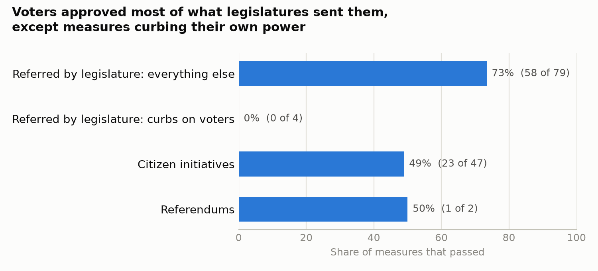
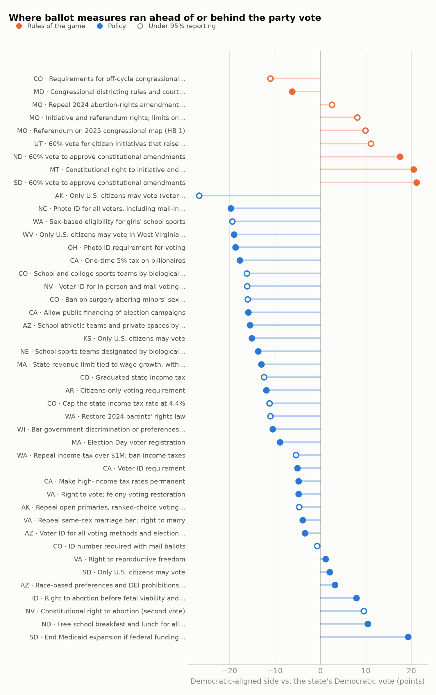

# Rules of the Game: 2026 ballot measures vs. the party vote

Voters in 2026 elected Democrats up and down the ballot and, often on the same ballot, passed voter ID laws, citizenship
requirements for voting and limits on transgender athletes. That kind of split is familiar. This project looks for a
less familiar one: what happens when the question on the ballot is about **voters' own power** to make decisions.

It collects the results of the statewide measures on the Nov. 3, 2026 ballot, compares each partisan measure with
the Democratic share of the vote for candidates in the same state, and asks which kinds of measures broke from party
lines.

*All results are unofficial, from [CivicAPI](https://civicapi.org), as of Nov. 20, 2026. 31 of the 133 measures with
yes/no results were under 95 percent reporting; they are marked in the chart and in
[`results/measure_results.csv`](results/measure_results.csv).*

## Findings

### 1. Voters approved most of what legislatures sent them, except curbs on their own power



Measures that legislatures referred to the ballot passed 73 percent of the time (58 of 79). Citizen initiatives passed
about half the time (23 of 47), in line with the usual pattern: voters tend to approve what lawmakers send them and are
more skeptical of outside proposals.

Four legislative referrals went the other way. All four would have limited what voters can decide, and all four lost:

| Measure | What it would have done | Yes |
|---|---|---|
| North Dakota Measure 1 | Require 60% for future constitutional amendments | 43.5% |
| South Dakota Amendment L | Require 60% for future constitutional amendments | 42.4% |
| Utah Amendment B | Require 60% for citizen initiatives that raise taxes | 38.6%* |
| Missouri Amendment 3 | Repeal the abortion-rights amendment voters passed in 2024 | 47.8% |

\* Utah was at 10 percent reporting in CivicAPI when this was run.

At the same time, voters approved citizen initiatives that protect the initiative process itself: Missouri's
Amendment 6 (57.8%) and Montana's CI-133 (65.4%). Missouri voters also rejected their legislature's 2025 mid-decade
congressional map by referendum, with 40.5 percent voting to keep it.

### 2. On process, voters broke from party lines more than on almost anything else



For each measure with a clear partisan alignment, I compared the share voting for the Democratic-aligned side with the
Democratic share of the two-party vote for Senate and governor in that state (or for the House, where neither race was a
Democrat-versus-Republican contest). A positive gap means the Democratic-aligned side ran ahead of Democratic candidates.

| Topic | Mean gap (points) | Measures |
|---|---:|---:|
| Direct democracy (thresholds, initiative rights) | +15.7 | 5 |
| Abortion | +5.2 | 4 |
| Redistricting | −2.4 | 3 |
| Voter ID | −10.6 | 6 |
| Taxes | −10.8 | 6 |
| Citizen-only voting | −14.1 | 5 |
| Gender (sports, minors) | −15.3 | 6 |

The process measures stand out. In South Dakota, the "no" side on the 60 percent threshold ran 21 points ahead of the
Democratic vote; in North Dakota, 18. These are states Donald Trump carried by 29 and 37 points.

**Congressional maps are a partial exception.** In all three map measures, the side against partisan mapmaking ran
ahead of the party that stood to gain: Missouri voters rejected the Republican map with 10 points more than the
Democratic vote; in Colorado, a limit on mid-decade redistricting drew about 11 points more than the Republican vote;
and Maryland's measure giving its Democratic legislature more room on congressional maps ran 6 points behind Democrats.
But in Colorado and Maryland the governing party's side still won. On maps, voters lean away from partisanship without
abandoning it; on thresholds and initiative rights, the break is much larger.

## Method

- **Measures** (`data/measures.csv`): 134 statewide yes/no measures on the Nov. 3 ballot, with how each reached the
  ballot, its approval threshold and a link to an official source. Idaho's multiple-choice advisory vote isn't a yes/no
  question and is left out; D.C.'s Initiative 86 had no results yet, leaving 133 in the analysis.
- **Coding:** the topic, the Democratic-aligned side and the "rules of the game" category are my own judgment, written
  into the CSV so they can be checked or changed. Measures without a clear partisan alignment have no side and are not
  in the gap analysis.
- **Party vote:** for each state, the mean Democratic two-party share across its Senate and governor races where a
  Democrat and a Republican finished first and second (`data/party_races.csv`). States without such a race use their
  contested House races combined. Montana's Senate race, between a Republican and an independent, is excluded, so Montana
  uses its House vote.
- **Passing:** a measure passes when its yes share meets its threshold (50%, or 55% to 66.7% in some states).

## Caveats

- Results are unofficial and some are incomplete; rerun `fetch.py --refresh` after states certify.
- The gap compares a measure with the vote for candidates, not individual voters' choices, and measures draw some
  voters who skip the candidate races.
- Small numbers: there are only nine "rules of the game" measures, and a single election. Earlier fights over initiative
  thresholds, like Ohio's August 2023 Issue 1, are the natural next step for testing whether this is a lasting pattern.

## Run it

```sh
python3 -m venv .venv && .venv/bin/pip install -r requirements.txt
.venv/bin/python fetch.py      # downloads results into cache/ (about 5 minutes the first time)
.venv/bin/python analyze.py    # writes results/ and charts/
```

Data: [CivicAPI](https://civicapi.org) for results; measure metadata from each state's official ballot materials.
